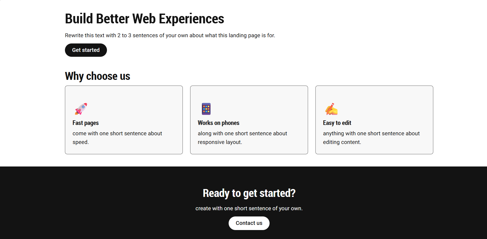

# AEM Landing Page (Edge Delivery Services)

A small marketing landing page built on Adobe's AEM Edge Delivery Services boilerplate, with two custom blocks.

## What I built
- A landing page with a heading, a section of three feature cards, and a call-to-action banner.
- `feature-list` block: shows features as a responsive grid of cards (written in JavaScript and CSS).
- `cta-banner` block: shows a highlighted banner with a heading, a short line of text and a button (JavaScript and CSS).
- The page itself is in `drafts/index.html`.

## Screenshot


## How to run it locally
You need Node.js installed.

```
npm i
npm install -g @adobe/aem-cli
aem up --html-folder drafts --open /drafts/index
```

The page opens in your browser.

## Challenges I faced
- Connecting a content source through da.live gave a "not authorized" error, so I ran the page locally with the AEM CLI and a `drafts` folder instead.
- The page showed the wrong content because an old `index.html` from another project was in my `drafts` folder. I found it with a Command Prompt check and replaced it with the correct file.

## What I learned
- Edge Delivery Services builds pages from blocks, and each block has its own JavaScript and CSS file.
- How to run an AEM project locally with the AEM CLI and push it to GitHub.

## Credits
Built on Adobe's boilerplate: https://github.com/adobe/aem-boilerplate
